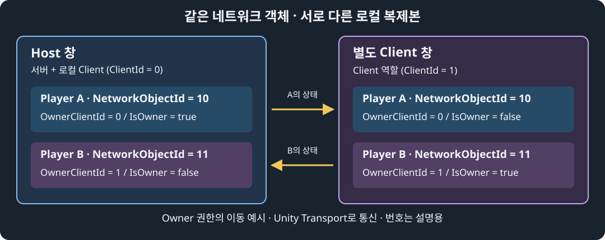

# NGO 기본 구조와 컨셉

이 문서는 **NGO (Netcode for GameObjects) 2.13.3** 을 기준으로, 연결한 뒤 플레이어가 생성되고 움직임이 공유되는 과정을 설명하는 보충 자료입니다. 새로운 수업 일차를 추가하지 않으며 [DAY09](../DAY09_NGO_NETWORK_MANAGER_HOST_CLIENT.md)부터 DAY11까지 이어서 활용합니다.

먼저 **Host 한 개와 별도 Client가 연결되는 클라이언트–서버 방식** 을 이해합니다. 그다음 전송 방식, Relay, 확장 가능성을 살펴봅니다. 기본 연결·이동 실습은 앞부분의 구조를 확인하는 활동이며, 뒤쪽 확장 내용까지 모두 구현해야 하는 것은 아닙니다.

## 1. 콘솔 네트워크에서 NGO로 넘어가기

콘솔 실습에서는 주소·포트를 정하고, 패킷의 종류와 길이를 읽고, 데이터를 해석한 뒤 다른 참여자에게 전달했습니다. Unity에서도 이 작업은 필요하지만, 게임에는 “어느 플레이어를 만들고 어떤 객체의 위치를 바꿀 것인가?”라는 문제가 더해집니다.

NGO는 **Unity 오브젝트를 네트워크에서 식별·생성하고, 지정한 상태와 함수 호출을 전달하는 작업** 을 돕는 라이브러리입니다. 비유하면 각 컴퓨터에 같은 경기장의 모형을 놓고, 선수와 점수판의 변화가 서로 맞도록 전달하는 관리 체계입니다.

여기서 먼저 세 용어를 구분합니다.

- **프로세스 (Process)**: 실행 중인 프로그램의 단위입니다. Editor와 빌드한 실행 파일은 별도의 메모리에서 동작합니다.
- **복제본 (Replica)**: 같은 네트워크 객체를 각 실행 환경에서 표현하는 로컬 객체입니다.
- **동기화 (Synchronization)**: 대응 복제본에 상태 변경을 전달하는 작업입니다. 모든 화면이 지연 없이 같은 순간에 완전히 같다는 뜻은 아닙니다.

연결된 프로그램들이 C# 객체 한 개의 메모리를 직접 공유하는 것은 아닙니다. 또한 **연결했다고 모든 오브젝트와 모든 필드가 자동 동기화되지는 않습니다.** 생성할 객체, 공유할 값, 값을 바꿀 주체는 개발자가 정합니다.

### 콘솔의 패킷 규격을 그대로 사용하나요?

아닙니다. 콘솔에서 만든 `타입 2바이트 + 길이 4바이트 + JSON`은 별도 규약입니다. **JSON (JavaScript Object Notation)** 은 이름과 값으로 데이터를 표현하는 텍스트 형식입니다. **직렬화 (Serialization)** 는 데이터를 전송·저장 가능한 표현으로 바꾸는 작업입니다.

NGO의 기본 동기화는 NGO의 메시지 규약과 직렬화 체계를 사용합니다. 콘솔 서버에 NGO Client를 연결한다고 서로의 메시지를 바로 이해하지는 않습니다. 다른 언어로 서버를 작성하더라도 상대 규약을 구현해야 한다는 원리는 같습니다.

이제 “누가 연결을 받고, 누가 참가하는가?”부터 살펴봅니다.

## 2. 연결을 시작하는 역할: Server, Client, Host

| 역할 | 하는 일 | 시작 메서드 |
| --- | --- | --- |
| Server (서버) | 접속을 받아 게임 연결과 네트워크 객체를 관리 | StartServer() |
| Client (클라이언트) | 서버에 접속해 게임에 참가 | StartClient() |
| Host (호스트) | 하나의 실행 인스턴스에서 서버와 로컬 Client를 함께 실행 | StartHost() |

**세션 (Session)** 은 함께 연결되어 게임을 진행하는 한 묶음입니다. 이 문서에서는 NGO의 게임 연결 묶음을 뜻합니다. 별도 온라인 서비스의 세션 API와는 구분합니다. **API (Application Programming Interface)** 는 프로그램이 다른 기능을 사용하는 접점입니다.

Host는 프로그램을 두 개 실행한다는 뜻이 아닙니다. 한 실행 인스턴스가 서버와 참가자의 두 역할을 맡습니다. 반면 **전용 서버 (Dedicated Server)** 는 플레이어 프로그램과 별도로 서버 역할만 운영하는 형태입니다. 플레이어로 직접 참여하지 않고, 접속한 클라이언트들의 게임 진행을 관리합니다.

### 역할을 확인하는 값

| 실행 역할 | IsHost | IsServer | IsClient |
| --- | --- | --- | --- |
| Host | true | true | true |
| 서버만 실행 | false | true | false |
| 별도 Client | false | false | true |

**Host에서는 IsHost, IsServer, IsClient가 모두 true입니다.** 서로 배타적인 세 선택지가 아닙니다. IsServer와 IsClient를 각각 독립된 if로 검사하면 Host에서는 두 코드가 모두 실행됩니다.

IsClient는 클라이언트 역할을 나타내며 접속 완료 여부와 다릅니다. **IsConnectedClient** 는 접속 승인과 초기 동기화까지 끝났는지 확인할 때 사용합니다. StartClient가 true를 반환한 것도 연결 시도를 시작했다는 의미이지, 상대 서버에 접속을 완료했다는 의미는 아닙니다.

### 참가자끼리는 누구를 통해 통신하나요?

현재 구성에서는 서버가 가운데 있습니다. Client A의 변경이나 요청을 다른 Client B에게 전달하는 경우 서버를 거칩니다. Host가 있으면 그 Host가 서버 역할을 맡습니다.

**P2P (Peer-to-Peer)** 는 참여자끼리 직접 통신하는 형태를 가리킵니다. **피어 (Peer)** 는 통신에 참여하는 한쪽입니다. 피어라는 말을 쓴다고 반드시 모든 참여자가 서로 직접 연결되는 구조는 아닙니다.

- 한 명은 Host, 나머지는 Client: 현재 수업의 클라이언트–서버 구성입니다.
- 모두 Client: 접속할 서버가 따로 필요합니다.
- 모두 Host: 각자 별도 서버를 시작할 뿐, 하나의 게임에 자동 연결되지 않습니다.

서버 역할만 하는 인스턴스를 쓰면 전용 서버 구성이고, 참가자 한 명이 서버 역할도 맡으면 Host 구성입니다. 플레이어 프로그램을 서버로 사용하는 형태를 넓은 의미의 P2P라고 부르는 경우가 있어도, **이 수업의 NGO 연결은 Host를 중심으로 한 구조** 로 이해합니다.

> NGO 2.13.3에는 분산 권한 (Distributed Authority) 구성도 있습니다. 여러 Client가 객체별 권한을 나누는 별도 구성으로, 모든 참여자를 Host로 시작하는 방법이 아닙니다. 권한을 분산하는 것과 모든 피어가 서로 직접 연결되는 것도 같은 의미가 아닙니다. 이 문서의 Server·Owner 설명은 현재 클라이언트–서버 구성을 기준으로 읽습니다.

## 3. 어디로 연결하는가: NetworkManager와 Unity Transport

**NetworkManager는 경기장 운영실**, **Unity Transport는 실제 전달 통로** 로 생각하면 쉽습니다.

| 구성 요소 | 책임 | 자동으로 해 주지 않는 일 |
| --- | --- | --- |
| NetworkManager | 연결 시작·종료, 참여자와 네트워크 객체 관리 | 게임 규칙과 요청 검증 전체 |
| Unity Transport | 주소·포트 설정, 실제 연결과 메시지 전송 | 접속할 Host를 자동 발견 |
| 게임 스크립트 | 입력·이동·점수·화면 표시·검증 | 모든 필드의 자동 공유 |

**IP (Internet Protocol) 주소** 는 네트워크에서 컴퓨터 등의 통신 대상을 가리키는 주소입니다. **포트 (Port)** 는 그 대상 안에서 통신 프로그램의 수신 지점을 구분하는 번호입니다. **엔드포인트 (Endpoint)** 는 주소와 포트로 지정한 목적지 또는 수신 지점입니다.

DAY09는 같은 컴퓨터에서 두 프로그램을 실행하므로 Client의 목적지가 **127.0.0.1:7777** 입니다. 127.0.0.1은 자기 컴퓨터를 가리키는 **루프백 (Loopback)** 주소입니다. 다른 컴퓨터의 Client에서 이 주소를 사용하면 Host 컴퓨터가 아니라 Client 자신의 컴퓨터를 찾습니다.

**Inspector (인스펙터)** 는 선택한 오브젝트·에셋의 컴포넌트와 설정값을 확인하고 수정하는 Editor 창입니다. NetworkManager의 **Network Transport** 칸에는 실제로 사용할 Unity Transport 컴포넌트를 연결해야 합니다. 컴포넌트가 존재하는 것과 관리자가 그것을 사용하도록 참조하는 것은 다릅니다.

연결 준비는 다음 순서입니다.

1. 양쪽 실행 프로그램이 대응 씬·프리팹·스크립트를 준비합니다.
2. NetworkManager에 Unity Transport를 연결하고 주소·포트를 지정합니다.
3. 한쪽에서 Host를 시작합니다.
4. 다른 쪽에서 Client를 시작해 Host의 엔드포인트로 접속합니다.
5. 연결 승인과 초기 동기화를 완료합니다.

코드에 주소를 직접 넣지 않는 예제도 컴포넌트나 서비스 설정에서 목적지를 얻습니다. 목적지 정보 없이 접속하는 것은 아닙니다. 이제 접속 후 어떤 플레이어가 생성되는지 살펴봅니다.

## 4. 연결한 뒤 무엇이 생기는가: 객체와 복제본

### NetworkObject와 NetworkBehaviour

**NetworkObject** 는 네트워크 이름표입니다. 객체의 식별자와 소유자 정보를 관리하고 네트워크 생성·제거의 기준이 됩니다. 이것만 붙여도 위치·체력·애니메이션이 전부 전달되는 것은 아닙니다.

**NetworkBehaviour** 는 네트워크 생성 상태, 역할, 소유권 정보를 사용하는 스크립트의 기반 클래스입니다. IsOwner 같은 값을 확인하고, NetworkVariable이나 RPC로 공유할 상태·요청을 정의할 수 있습니다.

여기서 **NetworkVariable** 은 네트워크로 유지·공유하는 변수이고, **RPC (Remote Procedure Call)** 는 다른 참여자에서 함수 실행을 요청하는 방식입니다. 구체적인 선택 기준은 7절에서 설명합니다.

DAY09 플레이어의 구성은 다음과 같습니다.

- 루트: NetworkObject, CharacterController, NetworkTransform, NetworkCharacterPlayer.
- 자식 Body: 캡슐 외형을 그리는 Renderer. 별도의 NetworkObject는 추가하지 않습니다.
- NetworkCharacterPlayer: NetworkBehaviour를 상속한 입력·이동 코드.

**Renderer** 는 외형을 화면에 그리는 컴포넌트이고, **CharacterController** 는 이동과 바닥·벽 충돌을 처리하는 컴포넌트입니다. 둘 다 네트워크 전달 자체를 맡지는 않습니다.

### 프리팹을 준비하고 네트워크에 생성하기

**프리팹 (Prefab)** 은 같은 구성의 객체를 만들기 위한 설계도 에셋입니다. **네트워크 프리팹 (Network Prefab)** 은 NetworkObject 등을 구성하고 네트워크 생성용으로 등록한 프리팹입니다.

상대 프로그램도 대응 프리팹과 스크립트를 가지고 있어야 합니다. 접속할 때 프리팹 에셋 전체를 상대에게 다운로드하는 방식이 아닙니다. 따라서 프리팹·스크립트를 바꾸면 실행 파일도 다시 빌드해야 합니다.

| 동작 | 의미 |
| --- | --- |
| Instantiate | 현재 실행 환경에 로컬 객체 생성 |
| Spawn | NGO에 네트워크 객체로 등록하고 관찰 대상에게 생성 정보 전달 |
| Despawn | NGO에서 네트워크 객체를 제거하도록 알림 |
| Destroy | 로컬 Unity 객체 제거 |

**스폰 (Spawn)** 은 이 문서에서 네트워크 객체의 생성·등록을 뜻합니다. Instantiate만 호출한다고 다른 창에 같은 네트워크 객체가 자동 생성되는 것은 아닙니다. 현재 구성의 Spawn·Despawn은 서버가 관리합니다.

**PlayerObject** 는 특정 Client의 대표 플레이어로 연결한 NetworkObject입니다. 일반 NetworkObject는 아이템·몬스터에도 사용합니다. 한 Client가 소유한 모든 객체가 반드시 PlayerObject인 것은 아닙니다.

NetworkManager의 Player Prefab과 자동 플레이어 생성 구성을 사용하면, 승인된 Client가 참가할 때 그 Client 소유의 PlayerObject를 NGO가 생성합니다. DAY09에서 직접 Instantiate·Spawn을 호출하지 않는 이유입니다.

### 두 창에 플레이어가 두 개씩 보이는 이유

Host 플레이어 A와 별도 Client 플레이어 B가 있고, 둘 다 양쪽에 공개되는 기본 관찰 구성을 가정합니다. **각 창에는 A와 B의 복제본이 모두 존재합니다.**

그림의 번호는 설명용이며 실제 배정 번호는 다를 수 있습니다.

- **ID (Identifier)**: 식별자입니다.
- **ClientId**: 접속 참여자의 식별 번호입니다.
- **NetworkObjectId**: 생성된 네트워크 객체의 식별 번호입니다.
- **OwnerClientId**: 그 객체를 소유한 참여자의 식별 번호입니다.

Host 창의 B와 Client 창의 B는 별도의 C# 객체입니다. 같은 NetworkObjectId로 대응할 뿐 메모리 주소를 공유하지 않습니다. 이름이 같은 Player를 양쪽에서 따로 만들었다고 NGO가 같은 객체로 연결하지도 않습니다.

## 5. 언제 초기화하는가: 네트워크 생명주기

**생명주기 (Lifecycle)** 는 객체가 만들어져 사용되고 정리되는 과정입니다. 로컬 객체 생성과 네트워크 생성은 같은 시점이라고 가정하지 않습니다.

| 실행 지점 | 할 일 |
| --- | --- |
| Awake | 로컬 컴포넌트 참조 준비. 네트워크 생성 완료를 가정하지 않음 |
| OnNetworkSpawn | 네트워크 생성 뒤 역할·소유권에 맞는 초기화 |
| Update | IsSpawned·IsOwner 등을 확인하고 현재 창에서 필요한 처리 |
| OnNetworkDespawn | 입력 액션·이벤트 구독 등 사용 중 만든 자원 정리 |

**IsSpawned** 는 현재 네트워크에 생성되어 있는지 나타냅니다. **OnNetworkSpawn** 은 NGO가 네트워크 생성 시 호출하는 메서드입니다. **override (재정의)** 는 기반 클래스의 동작을 하위 클래스에서 바꾸거나 확장하는 문법입니다.

DAY09에서는 Awake에서 CharacterController를 준비하고, OnNetworkSpawn에서 소유자 플레이어의 입력을 켭니다. 상대 복제본에서는 입력과 중력을 계산하지 않습니다.

Start와 OnNetworkSpawn의 순서는 동적 생성 객체와 씬에 미리 배치한 객체에서 다를 수 있습니다. 따라서 Start가 언제나 먼저라고 가정하거나 Awake에서 확인한 IsOwner로 입력을 영구적으로 결정하지 않습니다.

여러 NetworkBehaviour 사이에 초기화 의존 관계가 있는 고급 사례에서는 OnNetworkPostSpawn 같은 후속 지점도 검토합니다. 처음에는 **로컬 준비와 네트워크 준비를 분리한다** 는 원칙을 기억하면 됩니다.

## 6. 누구의 캐릭터이며 누가 결과를 결정하는가?

### 소유권과 IsOwner

**소유권 (Ownership)** 은 누구에게 객체가 배정되어 있는지를 나타냅니다. OwnerClientId가 소유자 번호이고, **IsOwner** 는 현재 실행 인스턴스가 그 객체의 소유자인지 확인하는 값입니다.

플레이어 입력에서는 “이 창의 참가자가 조작할 플레이어인가?”를 판단하는 데 사용합니다.

| 확인하는 실행 창 | Host 플레이어 A의 IsOwner | Client 플레이어 B의 IsOwner |
| --- | --- | --- |
| Host 창 | true | false |
| 별도 Client 창 | false | true |

IsServer는 실행 역할에 대한 질문이고, IsOwner는 **객체마다 다른 질문** 입니다. Host라고 모든 플레이어의 IsOwner가 true인 것은 아닙니다.

### 소유권과 권한은 별개

**권한 (Authority)** 은 특정 상태를 최종적으로 누가 결정하고 전송할지를 나타냅니다. 소유권은 “내 캐릭터라는 이름표”, 권한은 “최종 결과를 확정할 사람”입니다.

내 캐릭터라도 체력·점수는 서버가 결정할 수 있습니다. 권한은 위치·체력·점수 등 시스템별로 설계하며, 객체 하나에 설정한 권한이 모든 게임 규칙에 자동 적용되지는 않습니다.

**NetworkTransform** 은 위치·회전·크기의 변경을 전달하는 컴포넌트입니다. NGO 2.13.3에서는 일반 NetworkTransform의 Inspector에 있는 **Authority Mode** 로 결정 주체를 선택합니다.

| 설정 | 위치·회전 등 결정자 | Client가 직접 바꾼 위치 |
| --- | --- | --- |
| Server — 기본값 | 서버 | Client의 변경을 권한 있는 이동으로 전송하지 않음 |
| Owner | 해당 객체의 소유자 | 소유자의 변경을 서버와 다른 관찰 Client에게 전달 |

DAY09는 **Authority Mode = Owner** 입니다. CharacterController가 소유자 창에서 이동하고 NetworkTransform이 그 결과를 전달합니다. 상대 복제본에도 같은 NetworkTransform이 있어야 수신한 결과를 적용할 수 있습니다. “내가 조작하는 플레이어에만 붙이는 컴포넌트”가 아닙니다.

**Owner 모드도 서버를 없애거나 P2P 구조로 바꾸지 않습니다.** 현재 연결에서는 서버를 통해 상태가 전달됩니다. 또한 위치 권한을 Owner로 바꿔도 NetworkVariable의 쓰기 권한은 별도입니다.

**보간 (Interpolation)** 은 받은 상태들 사이를 이어 상대 이동을 부드럽게 표시하는 처리입니다. 네트워크 지연이 없어지는 것은 아닙니다. 동기화할 축과 보간 여부도 따로 설정합니다.

### OnIsServerAuthoritative가 false이면 누구에게 권한이 있나요?

OnIsServerAuthoritative는 **“현재 내가 소유자인가?”가 아니라 “서버 권한 방식을 사용할 것인가?”** 를 답하는 메서드입니다.

- true: 서버 권한 방식.
- false: 객체 소유자 권한 방식.

일반 NetworkTransform은 Authority Mode에 따라 판단한 뒤 실제 역할·소유권으로 전송 주체를 구분합니다. 모든 복제본에서 false라는 판단을 하더라도 모든 Client가 그 객체를 움직일 권한을 얻는 것은 아닙니다.

이전 예제의 OwnerNetworkTransform은 이 메서드를 재정의해 항상 false를 반환한 클래스였습니다. **2.13.3에서는 일반 NetworkTransform의 Authority Mode를 Owner로 선택하면 되므로 별도 클래스가 필요하지 않습니다.** 기존 씬에 해당 클래스가 남아 있다면 일반 NetworkTransform으로 교체하며 두 컴포넌트를 동시에 붙이지 않습니다.

### 전용 서버도 객체를 소유하나요?

네. 서버가 생성하고 소유하는 몬스터·아이템·문 같은 객체가 있을 수 있습니다. 서버가 플레이어로 직접 참여하지 않는다는 것이 네트워크 객체를 소유할 수 없다는 뜻은 아닙니다.

현재 구성에서 일반 객체를 Spawn하면 기본적으로 서버 소유입니다. 필요하면 SpawnWithOwnership으로 특정 Client에 배정하거나 ChangeOwnership으로 소유자를 바꿀 수 있습니다. 자동 PlayerObject 생성은 참가 Client 소유로 만드는 별도 흐름입니다.

### Client 소유 + Server 권한이면 어떻게 움직이나요?

Client는 입력을 보내고 서버가 실제 이동을 결정합니다.

1. Client는 자신의 Player에서 이동 입력을 읽습니다.
2. RPC 등으로 입력 요청을 서버에 보냅니다.
3. 서버는 요청자·소유권·입력 범위를 검사합니다.
4. 서버가 이동·중력·충돌 처리를 수행해 위치를 바꿉니다.
5. Server 권한 NetworkTransform이 결과를 Client들에게 전달합니다.
6. Client는 자신의 캐릭터와 상대 캐릭터의 결과를 표시합니다.

이때 **소유자는 조작 요청을 보내는 참가자**, ** 위치 결정자는 서버**입니다. 전용 서버와 Host 모두 이 원리를 사용할 수 있습니다.

DAY09 코드의 설정만 Server로 바꾸면 별도 Client의 직접 이동은 권한 있는 서버 이동이 되지 않습니다. Host의 이동만 보면 정상처럼 보일 수 있지만, Host는 서버 역할도 하기 때문입니다. 올바른 서버 권한 구현에는 위 흐름으로 코드 변경이 필요합니다.

입력 직후 반응을 빠르게 보여 주는 예측과 서버 결과에 맞추는 보정도 별도 설계입니다. Authority Mode를 바꾸는 것만으로 완성되지 않습니다. 입력 요청·검증은 DAY11에서 이어서 학습합니다.

## 7. 무엇을 전달할 것인가: 이동, 상태, 요청

| 전달할 내용 | 우선 살펴볼 도구 | 예 |
| --- | --- | --- |
| 현재 위치·회전 | NetworkTransform | 캐릭터 이동 결과 |
| 유지해야 하는 현재 상태 | NetworkVariable | 체력·점수·문 열림 여부 |
| 실행 요청·일회성 알림 | RPC | 공격·아이템 사용 요청 |

### NetworkTransform: 이동 결과

CharacterController가 실제로 이동하고 NetworkTransform은 그 결과를 전달합니다. NetworkTransform 자체가 키 입력·중력·충돌 규칙을 구현하지는 않습니다.

NetworkObject와 이동 코드만 있다면 생성은 공유되어도 이후 로컬 이동이 자동 전달되는 것은 아닙니다.

### NetworkVariable: 지금의 상태

NetworkVariable은 읽기·쓰기 권한에 따라 값을 동기화하는 변수입니다. 현재 클라이언트–서버 구성의 기본값은 모든 Client가 읽고 서버가 쓰는 방식입니다. 필요하면 권한을 명시적으로 바꿉니다.

늦게 참가한 Client도 자신에게 읽기 권한이 있는 현재 상태를 초기 동기화로 받을 수 있습니다. 반면 일반 int 필드는 변경해도 상대 창의 값이 바뀌지 않습니다.

값 동기화와 화면 갱신도 별개입니다. **OnValueChanged** 는 값 변경 알림이며, 화면 코드는 초기 값 반영과 변경 알림 처리를 함께 구현해야 합니다. 텍스트가 자동 갱신되지는 않습니다.

### RPC: 다른 참여자에게 실행 요청

예를 들어 Client가 점수 증가를 요청하면, 서버가 조건을 검사한 뒤 NetworkVariable의 점수를 바꿉니다. 다른 창은 변경된 점수를 표시합니다.

RPC는 현재 상태를 저장하는 변수와 다릅니다. 예전에 실행한 일회성 호출이 나중에 참가한 Client에게 자동 재생되지는 않습니다. 문을 여는 알림과 “현재 문이 열려 있음”이라는 유지 상태를 구분하는 이유입니다.

NGO의 Rpc 특성과 SendTo 설정으로 대상을 정하고 호출 허용 권한을 구성합니다. 서버는 요청자와 전달 값도 검사해야 합니다. **Client의 IsOwner 검사만으로 악의적인 요청까지 막았다고 판단하지 않습니다.**

같은 플레이어에서 위치는 Owner가 전달하고 점수는 Server가 결정하는 구성도 가능합니다. 도구와 권한을 공유할 내용에 맞게 선택합니다.

## 8. 개념을 Inspector 설정에 연결하기

각 구성 요소의 책임을 이해했다면 [NGO 핵심 컴포넌트 Inspector 설정 안내](NGO_COMPONENT_INSPECTOR_GUIDE.md)에서 실제 설정 칸과 연결합니다.

별도 문서는 NetworkManager, Unity Transport, NetworkObject, NetworkTransform, NetworkBehaviour 기반 스크립트를 중심으로 **항목의 역할·실습 설정·변경 시 영향** 을 설명합니다. CharacterController와 화면·입력 연결은 실습 보조 설정으로 구분합니다.

Inspector 설정을 확인한 뒤에는 씬·프리팹을 저장하고 실행 파일도 다시 빌드합니다. 이제 설정과 실행 흐름을 함께 이어 봅니다.

## 9. 연결부터 이동까지 한 흐름으로 읽기

이제 DAY09의 흐름을 처음부터 이어 봅니다.

1. 두 실행 프로그램이 대응 씬·Player Prefab·스크립트를 준비합니다.
2. NetworkManager에 Unity Transport를 연결하고 주소·포트를 지정합니다.
3. Host가 서버와 로컬 Client를 함께 시작합니다.
4. 별도 Client가 Host에 접속합니다.
5. 연결 승인·초기 동기화 과정에서 PlayerObject가 생성되고 소유자가 배정됩니다.
6. 각 창의 대응 객체에서 OnNetworkSpawn이 실행됩니다.
7. 각 참가자는 IsOwner가 true인 Player에서만 입력을 읽습니다.
8. CharacterController가 소유자 창의 캐릭터를 이동시킵니다.
9. Owner 권한 NetworkTransform이 결과를 전달해 다른 창의 복제본에 적용합니다.
10. 객체 제거 시 OnNetworkDespawn 등에서 입력 자원을 정리하고, 연결 종료도 처리합니다.

“버튼이 실행됐다”, “접속했다”, “플레이어가 생성됐다”, “움직임이 공유된다”는 서로 다른 확인 결과입니다. **앞 단계가 성공했다고 뒤 단계까지 성공한 것은 아닙니다.**

여기까지가 기본 실습의 핵심입니다. 다음부터는 같은 구조를 실제 온라인 환경으로 확장할 때의 참고 내용입니다.

## 10. NGO 아래에서는 어떤 방식으로 데이터를 보내나요?

**Transport (전송 계층)** 는 NGO의 메시지를 상대에게 전달하는 통로입니다. **UTP (Unity Transport Package)** 는 Unity의 저수준 네트워크 전송 패키지이고, NGO의 UnityTransport 컴포넌트는 이를 NGO에서 사용하도록 연결합니다.

게임 규칙·객체·권한을 다루는 NGO와 실제 데이터 전송을 다루는 Transport를 구분합니다. 컴포넌트 이름인 UnityTransport와 기반 패키지를 가리키는 Unity Transport라는 표현도 문맥에 맞게 읽습니다.

### UDP와 WebSocket

- **UDP (User Datagram Protocol)**: 데이터그램이라는 개별 메시지 단위로 보내는 전송 프로토콜입니다. 기본 프로토콜 자체는 도착·순서·재전송을 보장하지 않습니다.
- **TCP (Transmission Control Protocol)**: 연결된 양쪽 사이에 바이트를 순서대로 전달하는 신뢰성 있는 스트림 프로토콜입니다.
- **WebSocket**: 연결을 유지하며 양방향 메시지를 주고받는 프로토콜입니다. TCP 기반이며 웹 환경에서도 사용합니다.

UnityTransport는 기본적으로 UDP를 사용하고, **Use WebSockets** 설정으로 WebSocket 전송을 선택할 수 있습니다. 실제 구성은 대상 플랫폼과 사용하는 서비스의 지원 조건도 맞아야 합니다. WebSocket을 고른다고 HTTP 요청·응답 방식으로 NGO 게임 로직을 다시 작성하는 것은 아닙니다.

**HTTP (Hypertext Transfer Protocol)** 는 웹 요청·응답에 사용하는 프로토콜입니다. 일반적인 WebSocket 접속은 HTTP로 시작해 WebSocket으로 전환되지만, 연결 후 게임 메시지는 WebSocket의 양방향 통신으로 전달됩니다.

### UDP면 중요한 메시지도 유실되나요?

UDP의 기본 보장과 그 위에 구현한 기능을 구분해야 합니다. **신뢰성 (Reliability)** 은 필요한 데이터의 도착을 확인하고 유실 시 재전송하는 등의 보장입니다.

UTP는 **파이프라인 (Pipeline)** 이라는 전송 처리 조합으로 신뢰성·순서 보장·분할 같은 기능을 제공합니다. **분할 (Fragmentation)** 은 큰 메시지를 전송 가능한 작은 조각으로 나누는 처리입니다. 따라서 “NGO가 UDP를 사용하니 모든 메시지가 비신뢰 전송이다”라고 판단하면 안 됩니다.

다만 신뢰성을 사용하면 확인·재전송에 따른 비용과 대기가 생깁니다. 모든 데이터를 무조건 신뢰 전송으로 바꾸는 것도 게임 목적에 맞는 선택인지 검토해야 합니다.

### TCP Transport도 만들 수 있나요?

가능합니다. 다만 UnityTransport의 기본 설정에 UDP와 TCP를 단순 전환하는 선택지가 있다는 뜻은 아닙니다. NGO용 TCP Transport를 별도로 구현하거나 호환되는 구현을 사용해야 합니다.

TCP는 메시지 경계가 없는 바이트 스트림이므로 Transport 내부에서 NGO 메시지 단위로 구분해야 합니다. 콘솔의 길이 헤더 실습에서 배운 원리를 사용할 수 있습니다. 앞부분이 유실되면 뒤의 데이터도 순서대로 전달하기 위해 기다릴 수 있다는 특성도 고려합니다.

전송 방식이 바뀌어도 **게임 코드 → NGO 메시지 → Transport → 상대 Transport → NGO → 대응 객체** 라는 계층 구분은 유지됩니다.

## 11. 인터넷에서 직접 연결하기 어렵다면: Relay

로컬 실습이 성공해도 인터넷에서 같은 주소만 바꾸면 항상 연결되는 것은 아닙니다. 방화벽과 공유기의 **NAT (Network Address Translation, 네트워크 주소 변환)** 가 영향을 줍니다. NAT는 공유기가 내부 주소와 외부 주소·포트를 대응시켜 통신을 처리하는 기능입니다.

**Relay (중계)** 는 참여자들이 중계 서버에 접속하고 그 서버를 통해 메시지를 전달하는 방식입니다. 직접 접속이 어려운 참가자를 연결하는 데 활용합니다.

### 게임 서버와 중계 서버는 다른가요?

| 구분 | 맡는 일 | 일반적으로 맡지 않는 일 |
| --- | --- | --- |
| 게임 서버 역할 | 이동·점수·생성·검증 등 게임 진행 | 단순 패킷 전달만 수행하는 것이 아님 |
| Relay 서버 | 참여자 사이의 통신 데이터 중계 | 몬스터 행동·점수 규칙 등 게임 로직 |

현재 Host 구성에 Relay를 추가해도 **Host가 게임 서버 역할을 맡는 구조는 유지** 됩니다. 다른 Client 사이에 전달하는 상태는 논리적으로 Client A에서 Relay를 거쳐 Host에 도착하고, Host에서 Relay를 거쳐 Client B로 전달됩니다.

Relay를 사용했다는 사실만으로 전용 게임 서버가 생기거나, Host 종료 후 새 Host로 게임이 자동 이전되지는 않습니다. **Host 이전 (Host Migration)** 은 서버 역할과 필요한 게임 상태를 다른 참가자로 옮기는 별도 기능·설계입니다.

### Unity Relay는 직접 만들어야 하나요?

아닙니다. **Unity Relay** 는 Unity가 운영하는 중계 서비스입니다. 직접 중계 서버를 개발·배포하는 대신 서비스 사용을 설정하고, 생성·참가 과정에서 받은 연결 정보를 Transport에 적용합니다.

Unity 6의 신규 온라인 연결 구성은 Multiplayer Services의 세션 기능을 통해 Relay 사용을 구성하는 경로도 제공합니다. 현재 DAY09의 루프백 직접 접속과는 다른 확장 실습이며, Relay를 쓸 때도 참가 절차와 접속 정보가 필요합니다.

서비스에는 무료 사용 범위와 유료 사용 조건이 있습니다. **CCU (Concurrent Users)** 는 동시에 접속한 사용자 수를 뜻합니다. 과금에서 쓰는 월평균 동시 접속 지표를 순간 최대 인원과 혼동하지 않습니다. 트래픽 등 사용량도 비용에 영향을 주므로 실제 도입 시 [공식 가격 안내](https://unity.com/products/gaming-services/pricing)를 확인합니다. 이 문서에서는 변동 가능한 무료량·단가를 고정하지 않습니다.

### 직접 만든 Relay를 사용할 수도 있나요?

가능하지만 직접 만든 서버가 Unity Relay 서비스로 등록되는 것은 아닙니다. **자체 중계 프로토콜과 NGO용 Transport의 호환** 을 함께 해결해야 합니다.

Unity Relay용 연결 정보를 받는 코드에 자체 서버 IP만 바꾼다고 작동하지는 않습니다. 주소 외에도 접속·메시지 전달 규약이 맞아야 합니다. 기존 전송 기능을 활용할지, Transport를 바꿀지는 중계 서버의 규약에 따라 판단합니다.

## 12. 참고: Transport를 직접 확장하는 방법

기본 실습에서는 구현하지 않는 심화 내용입니다. “NGO를 유지하면서 전송 통로를 바꿀 수 있는가?”에 대한 선택지를 정리합니다.

### NetworkTransport를 상속하는 방법

**NetworkTransport** 는 NGO가 전송 통로에 기대하는 기능을 정의한 추상 기반 클래스입니다. **추상 클래스 (Abstract Class)** 는 하위 클래스가 구현해야 하는 기능을 제시하는 기반 클래스입니다.

자체 Transport를 만들려면 이를 상속하고 다음 책임을 구현합니다.

| 책임 | 관련 API 예 |
| --- | --- |
| 시작·초기화·종료 | Initialize, StartServer, StartClient, Shutdown |
| 메시지 전송·이벤트 전달 | Send, PollEvent 또는 OnTransportEvent 알림 |
| 연결 정리 | DisconnectLocalClient, DisconnectRemoteClient |
| 서버 식별·통신 지연 정보 | ServerClientId, GetCurrentRtt |

**RTT (Round-Trip Time)** 는 데이터를 보낸 뒤 응답을 받기까지의 왕복 시간입니다. 실제로 재정의할 서명과 요구사항은 사용하는 NGO 버전의 NetworkTransport API로 확인합니다.

게임 코드가 NetworkTransport를 직접 매번 호출하는 구조가 아니라, NetworkManager가 설정된 Transport를 사용합니다. 자체 TCP·UDP·중계 방식도 이 계약에 맞춰 연결할 수 있습니다. UDP를 그대로 사용하는 자체 구현이라면 필요한 신뢰성·순서 보장 기능도 어디서 제공할지 정해야 합니다.

### UnityTransport 자체도 상속할 수 있나요?

NGO 2.13.3의 UnityTransport는 상속을 막는 sealed 클래스가 아니므로 상속할 수 있습니다. 그러나 **상속 가능과 내부 동작 전체를 자유롭게 재정의할 수 있다는 것은 다릅니다.** 재정의 가능한 메서드와 private 내부 구현을 구분해야 합니다.

기존 UTP 동작을 활용하려는 경우에는 드라이버 생성 확장점도 검토할 수 있습니다. **NetworkDriver** 는 저수준 연결·이벤트·전송을 처리하는 객체입니다. **INetworkStreamDriverConstructor** 는 NetworkDriver와 전송 파이프라인을 구성하는 확장 인터페이스입니다. **인터페이스 (Interface)** 는 구현할 기능의 계약을 정의합니다.

선택 기준은 다음과 같습니다.

- 전송 방식 전체가 다름: NetworkTransport 구현을 검토합니다.
- 기존 UTP를 유지하며 구성 일부를 바꿈: UnityTransport의 지원 확장점·드라이버 구성을 검토합니다.
- 기존 기능 그대로 충분함: 새 Transport를 만들지 않고 설정을 사용합니다.

이 단계는 저수준 통신, 메시지 경계, 연결 종료, 오류 처리까지 책임져야 합니다. 수업의 입문용 이동 실습에 먼저 넣을 내용은 아닙니다.

## 13. DAY09에서 구조를 확인하기

이 문서는 개념 보충 자료입니다. 새 프로젝트 생성 절차는 반복하지 않고 [DAY09 안내형 실습](../DAY09_NGO_NETWORK_MANAGER_HOST_CLIENT.md)을 활용합니다.

**미션:** 각 구성 요소의 책임을 실제 두 실행 창에서 구분합니다.

1. Player Prefab에 일반 NetworkTransform을 하나만 두고 Authority Mode를 Owner로 설정합니다. 위치·회전 항목도 DAY09에 맞춥니다.
2. 씬·프리팹을 저장하고 실행 파일을 다시 빌드합니다.
3. Editor에서 Host, 실행 파일에서 Client를 시작합니다.
4. Host의 참여자 2명 표시, Client 연결 완료 표시, 플레이어 복제본 두 개를 각각 확인합니다.
5. 창을 번갈아 조작하며 자신의 캐릭터만 움직이고 상대 창에도 같은 이동이 보이는지 확인합니다.
6. 두 실행을 종료합니다. Authority Mode를 Server로 바꾸고 다시 빌드하여 같은 과정을 비교합니다. 실습이 끝나면 Owner로 복원하고 다시 빌드합니다.

**입력 초점 (Focus)** 은 키보드 입력을 받는 창을 뜻합니다. Editor의 Game 뷰와 실행 파일 창 중 조작할 쪽을 클릭한 뒤 입력합니다.

**예상 관찰:** Owner에서는 각 참가자가 자기 캐릭터를 움직입니다. Server로 설정만 바꾸면 별도 Client의 직접 이동은 정상적인 서버 권한 이동으로 전달되지 않습니다. IsOwner 검사와 Authority Mode가 각각 다른 문제를 해결한다는 것을 확인합니다.

### 응용 과제

- 각 플레이어의 소유자 번호를 표시합니다.
- 현재 역할과 접속 완료 여부를 구분해 표시합니다.
- 플레이어 위치는 Owner 권한, 점수는 Server 쓰기 권한으로 구성합니다.
- 상대 이동이 보이지 않을 때 확인할 컴포넌트·설정 목록을 작성합니다.

## 오늘의 정리

NGO 학습은 **연결 → 객체 생성 → 소유권·권한 판단 → 필요한 상태·요청 전달 → 대응 복제본에 적용** 으로 이어집니다.

헷갈릴 때는 다음 질문을 순서대로 확인합니다.

1. 어디로 연결하며 누가 서버 역할을 맡는가?
2. 어떤 네트워크 객체가 생성되었는가?
3. 누구의 객체이며 이 값은 누가 결정하는가?
4. 무엇을 어떤 도구로 전달하는가?
5. 받은 결과를 어느 복제본과 화면에 적용하는가?

Transport와 Relay는 이 흐름의 **전달 통로** 를 바꾸거나 돕는 기능입니다. 그것만으로 소유권·게임 판정·입력 검증이 자동 완성되지는 않습니다.

### 생각해보기

1. Host의 IsServer와 IsClient가 모두 true인 이유는 무엇인가요?
2. Client가 Player를 소유해도 서버가 위치나 체력을 결정할 수 있는 이유는 무엇인가요?
3. 플레이어가 생성됐지만 움직이지 않을 때 접속 여부만 확인하면 충분할까요?
4. RPC로 문을 한 번 열었다면 늦게 참가한 Client에게 어떤 상태가 필요할까요?
5. Relay 서버가 패킷을 전달한다면 실제 몬스터 행동은 어디에서 계산하나요?

## 이어서 읽기

- [DAY09: 연결과 CharacterController 이동 확인](../DAY09_NGO_NETWORK_MANAGER_HOST_CLIENT.md)
- [DAY10: 소유권, NetworkVariable, RPC](../DAY10_NGO_OWNERSHIP_NETWORKVARIABLE_RPC.md)
- [DAY11: 입력 요청과 서버 권한 상호작용](../DAY11_NGO_INPUT_SERVER_AUTHORITY_INTERACTION.md)

## 공식 참고 자료

아래 NGO 문서는 2.13 계열이며 수업 기준은 2.13.3입니다. 온라인 서비스의 정책·제한·요금은 도입 시 다시 확인합니다.

- [NetworkManager와 접속 설정](https://docs.unity3d.com/Packages/com.unity.netcode.gameobjects@2.13/manual/components/core/networkmanager.html)
- [NetworkObject와 소유권](https://docs.unity3d.com/Packages/com.unity.netcode.gameobjects@2.13/manual/components/core/networkobject.html)
- [NetworkObject API와 Inspector 주요 설정](https://docs.unity3d.com/Packages/com.unity.netcode.gameobjects@2.13/api/Unity.Netcode.NetworkObject.html)
- [PlayerObject와 자동 생성](https://docs.unity3d.com/Packages/com.unity.netcode.gameobjects@2.13/manual/components/core/playerobjects.html)
- [NetworkBehaviour와 생명주기](https://docs.unity3d.com/Packages/com.unity.netcode.gameobjects@2.13/manual/components/core/networkbehaviour.html)
- [NetworkTransform API와 권한](https://docs.unity3d.com/Packages/com.unity.netcode.gameobjects@2.13/api/Unity.Netcode.Components.NetworkTransform.html)
- [NetworkVariable API](https://docs.unity3d.com/Packages/com.unity.netcode.gameobjects@2.13/api/Unity.Netcode.NetworkVariable-1.html)
- [RPC와 호출 대상](https://docs.unity3d.com/Packages/com.unity.netcode.gameobjects@2.13/manual/advanced-topics/message-system/rpc.html)
- [UnityTransport API와 확장점](https://docs.unity3d.com/Packages/com.unity.netcode.gameobjects@2.13/api/Unity.Netcode.Transports.UTP.UnityTransport.html)
- [NetworkTransport API](https://docs.unity3d.com/Packages/com.unity.netcode.gameobjects@2.13/api/Unity.Netcode.NetworkTransport.html)
- [분산 권한 구성](https://docs.unity3d.com/Packages/com.unity.netcode.gameobjects@2.13/manual/terms-concepts/distributed-authority.html)
- [Multiplayer Services의 Relay 연결](https://docs.unity.com/en-us/mps-sdk/networking/relay-servers)
- [Unity Gaming Services 가격 안내](https://unity.com/products/gaming-services/pricing)
- [Unity 6 CharacterController의 Inspector 설정](https://docs.unity3d.com/6000.0/Documentation/Manual/class-CharacterController.html)

> 이 자료는 공식 문서를 바탕으로 개념과 API를 정리한 학습 문서입니다. 대상 Unity 프로젝트의 컴파일·두 창 연결·실제 입력과 이동을 실행 검증한 결과 보고서는 아닙니다.
